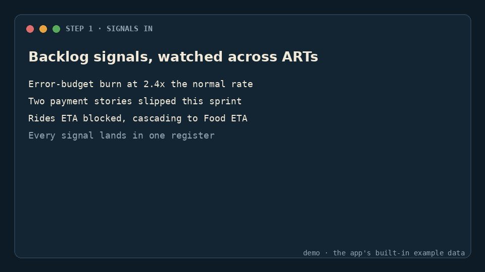
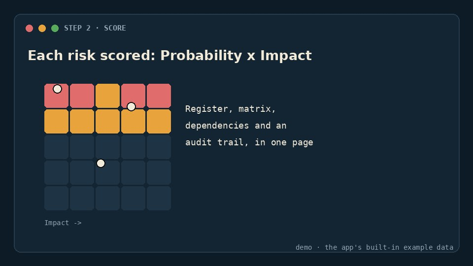
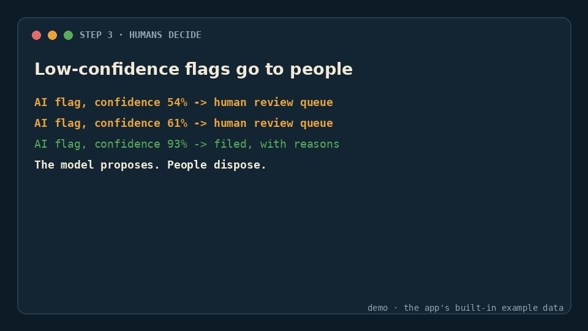

# Risk Radar

An AI-assisted delivery-risk dashboard for Scrum and SAFe teams. It monitors backlog signals across Agile Release Trains, scores risks by Probability x Impact, and routes low-confidence AI flags to a human review queue.

The whole app is one file: open `index.html` in a browser. It includes a risk matrix, a register, dependency tracking, an audit trail and human-in-the-loop controls.

## Watch how it works

The walkthrough takes about 15 seconds, with the app's built-in example data.

<table>
  <tr>
    <td align="center" width="33%"> <code>signals in</code>: watched across ARTs</td>
    <td align="center" width="33%"> <code>score</code>: probability x impact</td>
    <td align="center" width="33%"> <code>humans decide</code>: the review queue</td>
  </tr>
</table>

The docs are also available as [llms.txt](llms.txt) for coding agents.

## Support

Risk Radar is free and MIT-licensed. If it saved you time, a coffee helps: https://ko-fi.com/nils_effmert
